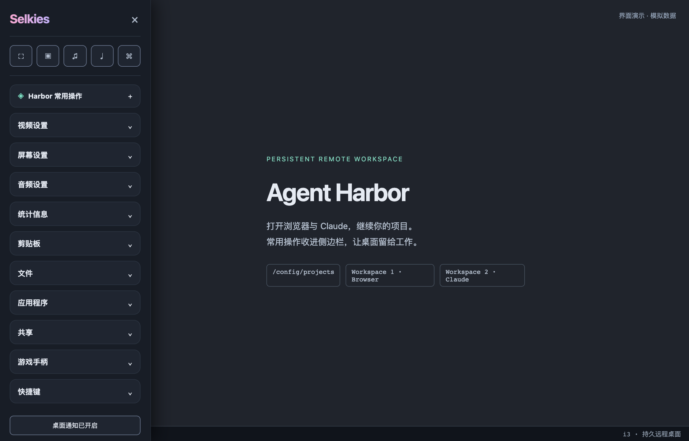
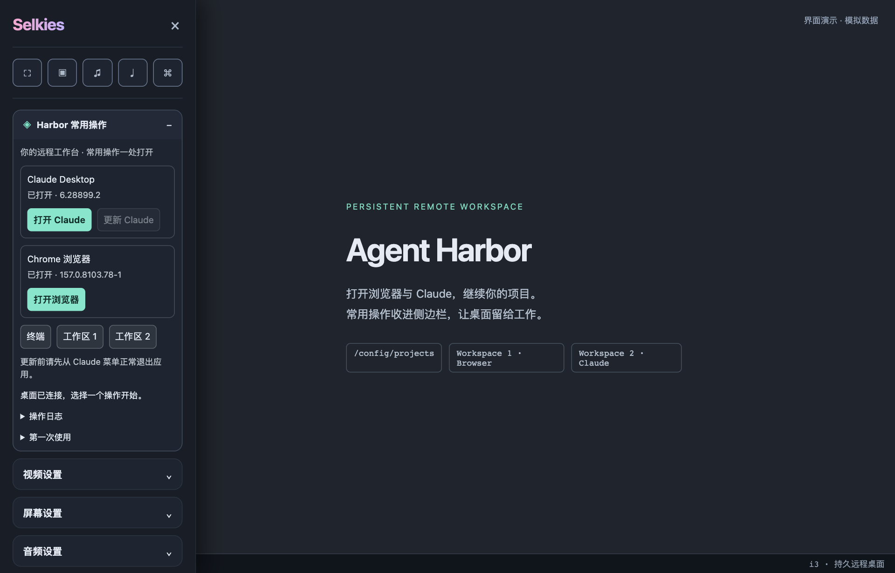
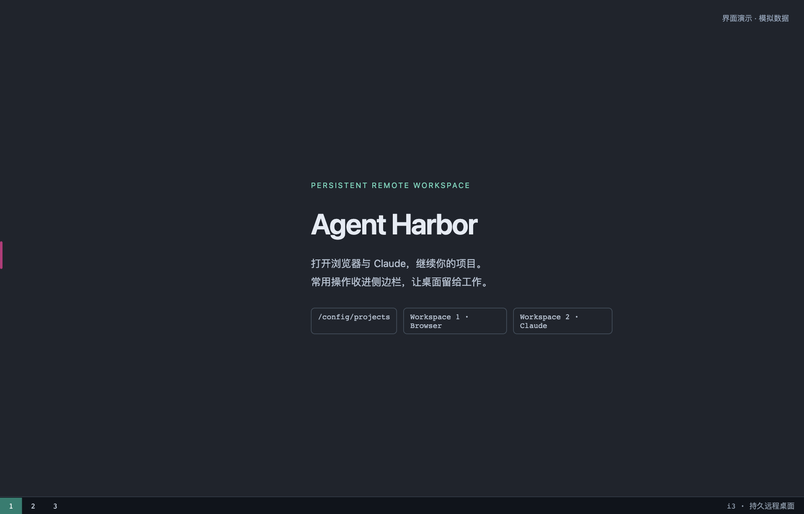

# Agent Harbor

可持久运行、可由其他 agent 复刻的远程桌面沙箱。基于 **Ubuntu + Docker Webtop / i3 + sing-box**，通过 **Tailscale Serve** 或 **Mac 持久 SSH 转发**访问。

出口服务器、DNS 上游与时区由部署参数决定。东京是最初运行实例和一个可选预设，不是方案依赖。首版支持 Shadowsocks-2022 / IPv4 TCP 后端；其他代理类型尚未实现。

**状态：实验性复刻基线。** 已有运行实例和隔离启动验证，尚未完成第二台空白机器的全流程重放。Chrome / Electron 的 `--no-sandbox` 仍是已知缺口，不能把它当成完整的浏览器进程沙箱或多租户系统。

[完整复刻指南](docs/REPRODUCE.md) · [验证记录](validation/DELIVERY-VALIDATION.md) · [后续路线图](docs/ROADMAP.md) · [贡献](CONTRIBUTING.md)

## 桌面操作预览

打开 Selkies 侧边栏，展开 **Harbor 常用操作**，即可打开 Claude、浏览器和终端，切换工作区，并查看安装状态与操作日志。未安装的应用会显示安装按钮；更新 Claude 前先从应用菜单正常退出，面板会校验安装包、备份，再更新到仓库验证版本。

Harbor 默认折叠，浏览器会记住展开状态。关闭 Selkies 侧边栏后，Harbor 一起隐藏，桌面不保留额外悬浮按钮。

以下为干净演示画面，使用项目面板与固定版本 Selkies 样式；桌面背景及应用状态为演示数据，不包含真实账号或会话。具体接入与使用步骤见 [常用操作面板](docs/DESKTOP-CONTROLS.md)。

**侧边栏入口**：Harbor 位于原生设置列表顶部，和其他设置一样可展开、收起。



**展开常用操作**：应用入口、工作区、更新和日志集中在侧边栏内。



**收起侧边栏**：Harbor 随侧边栏隐藏，只保留 Selkies 原生侧边栏把手。



## 已有能力

| 范围 | 当前实现 |
| --- | --- |
| 桌面 | Webtop / Selkies / i3；用户数据持久化到项目目录 |
| 出站 | 三个容器共享 firewall namespace；只允许连接配置的代理 IPv4/TCP；拒绝直接 DNS 与 IPv6 出站 |
| DNS | 配置的 TCP DNS 上游，经同一加密代理访问，无本地直连后备 |
| 访问 | Ubuntu 仅发布 loopback；Tailscale Serve 持久 HTTPS；Mac launchd 持久 SSH 隧道 |
| 可复刻性 | 镜像摘要与 PRoot 应用层锁定，干净 HOME 种子，安装和只读验收工具 |
| 交互 | 动态分辨率、Mac 拼音与候选框、长文本粘贴、Command 编辑与 Control 桌面控制分离 |
| 应用 | Chrome、可选的 Claude Desktop（Linux beta）和独立 Claude Code CLI |
| 常用操作 | Selkies 侧边栏内的 Harbor 折叠面板：打开应用、安装浏览器 / Claude、更新 Claude、切换工作区与查看进度 |
| 开发工具 / GPU | 可选持久 Python / uv / Node / PDF 工具；NVIDIA 原生 CDI 透传及 CUDA 计算验收 |
| 会话恢复 | 桌面启动后重开已安装应用：工作区 1 Chrome、工作区 2 Claude；跳过已有进程 |
| 文件 | 内置 Web 文件管理器；默认 `/config/projects`，进入子目录后上传/下载 |
| 通知 | 页面在线时将 Linux 桌面通知转为浏览器通知；用户按站点开启 |

Tailscale 是进入桌面的管理通道，公网出站走所配置的代理；两条路径分开配置。首版不提供图形安装器，也没有自动根据出口切换时区、通用代理订阅管理或完整 VM 隔离。

文件上传入口和浏览器通知的使用方法、连接要求及验证范围见 [文件与通知](docs/FILES-NOTIFICATIONS.md)。开发工具、PRoot 两层路径及可选 GPU 配置见 [开发工具与 GPU](docs/DEVTOOLS-GPU.md)。

进入桌面后，打开 Selkies 侧边栏，展开 **Harbor 常用操作** 即可安装或打开浏览器、Claude 与终端。更新 Claude 前先正常退出应用；面板会安装仓库验证版本并备份现有应用层和个人状态。新手步骤、已有部署接入和失败恢复见 [常用操作面板](docs/DESKTOP-CONTROLS.md)。

Mac 触控板与连续滚轮的距离映射修复，以及当前 X11 的平滑滚动限制，见 [滚动映射](docs/SCROLLING.md)。

远程 Chrome 使用 1Password Passkey 的配置方式，以及手机扫码所需的蓝牙边界，见 [Passkey 登录](docs/PASSKEYS.md)。

## Claude Desktop

Anthropic 为 Debian 和 Ubuntu 提供官方 Linux beta。Agent Harbor 在 Webtop 内用 Debian PRoot 运行该应用。见 [官方 Linux 说明](https://code.claude.com/docs/en/desktop-linux)和[桌面启动与恢复](docs/DESKTOP-RECOVERY.md)。

新部署可在 **Harbor → 安装 Claude** 中完成固定应用层和 GNOME Keyring 安装。也可在 **Ubuntu 宿主机的仓库目录**运行以下两步。持久保存登录态、SSH 密码和 Environment 凭据需要可用且已解锁的钥匙串。

```sh
sudo docker exec -u abc sandbox-webtop \
  python3 /config/.local/lib/sandbox/install-proot-app.py claude
sudo docker exec -u abc -i sandbox-webtop /bin/bash -s < tools/install-secret-service.sh
```

随后从 Webtop 桌面运行 `sandbox-claude-desktop`（应用菜单为 `Control+Return`、`d`、`4`）。首次使用钥匙串时，按远程桌面弹窗设置非空密码，完成登录后退出重开验证。已有 Claude、只看到 **No system keyring is available** 的安装，可从第二条命令开始，再按故障排查检查服务和解锁状态。见 [钥匙串设置与故障排查](docs/SECRET-SERVICE.md#安装与启动)。

| 版本 | 含义 |
| --- | --- |
| **5.1231.0** | [`apps.lock.json`](apps.lock.json) 固定的 PRoot 应用层，用于新部署复刻基线 |
| **6.28899.2** | 2026-11-21 在现有实例原地升级后验证的官方 `amd64` 包 |

已有实例出现升级提示时，先备份应用层、个人配置与钥匙串，再在现有 PRoot 内安装经过 SHA-256 校验的官方 `.deb`。这样可保留后装的钥匙串、浏览器授权跳转和开发工具。`proot-apps update claude` 会重建应用层，仓库安装器的 `--replace` 会重装锁定基线。见 [升级步骤和版本记录](docs/CLAUDE-UPDATES.md)。

- **项目环境**。Code 本地会话可选择 `/config/projects` 下的项目。修改已保存的 Environment 变量后，从该环境新建会话即可读取新值。见 [本地会话环境变量](https://code.claude.com/docs/en/desktop#set-environment-variables-for-local-sessions)。
- **Mac 长文本粘贴**。Selkies 从 Chrome 的原生粘贴事件取内容，传输完成后才触发远端粘贴。浏览器菜单或剪贴板历史工具发出的原生粘贴也可走这条路径。测试覆盖缺少按键事件、连续粘贴和跨分片的 UTF-8 长文本。见 [剪贴板回归测试](tests/clipboard-paste.test.cjs)。
- **验收范围**。源机已验证新版正常启动、原账号继续登录和历史会话可见。完整宿主重启后的钥匙串解锁仍待验收。Cowork 在 Linux 上另需 QEMU 和 KVM，本方案尚未验收这条路径。Claude 的 Computer Use 和语音听写以官方 Linux beta 支持范围为准。见 [Cowork 要求](https://code.claude.com/docs/en/desktop-linux#cowork-requirements)和 [Linux beta 功能范围](https://code.claude.com/docs/en/desktop-linux#whats-not-in-the-linux-beta-yet)。

## 从这里开始

目标平台：Ubuntu 24.04 / x86_64；Mac 为已验证的操作端。需要 Docker Compose、Python 3、Tailscale，以及自己的兼容代理服务器。

```bash
git clone https://github.com/Zephyr596/agent-harbor.git
cd agent-harbor
python3 tools/verify.py --static
cp .env.example .env
chmod 600 .env
# 编辑 .env：代理地址/密钥、DNS、时区、UID/GID。
python3 tools/prepare.py
sudo docker compose config --quiet
```

以上只准备配置；启动、Tailscale Serve、Mac 隧道和应用安装步骤见 [复刻指南](docs/REPRODUCE.md)。不要直接启动 `reference/` 下的历史 Compose。

默认 `SANDBOX_TZ=Etc/UTC`、`DNS_UPSTREAM_IP=1.1.1.1`。DNS 查询经代理传输；解析器地理位置需按部署需求独立确认。需要 AWS 东京设置时，可手动合并 [可选预设](examples/aws-tokyo.env.example)，不要把 AWS link-local DNS 用于普通 VPS。

## 仓库结构

- `compose.yaml`、`firewall/`、`config/`：参数化网络与桌面服务。
- `tools/`：配置准备、固定应用层安装、Mac 服务安装、完整性与运行验收。
- `desktop/`、`seed/`、`policies/`：版本绑定的桌面补丁、干净用户目录和浏览器策略。
- `server/`、`examples/`：服务端协议参考及可选预设。
- `validation/`、`CURRENT-ENVIRONMENT.md`：实际验证范围与最初实例的版本记录。
- `docs/`：复刻步骤、相关项目和逐步工具化路线图。

仓库不包含真实代理密钥、浏览器 Cookie、Claude 登录态、SSH 私钥或 Tailscale 节点身份。不要上传运行后的 `.env`、`config/sing-box.json` 或 `webtop-data/`。

## 相关项目与许可

[Claude-Cage](https://github.com/Lee-xeo/Claude-Cage) 是后续工作台和部署体验的参考项目；本仓库独立整理已有 Webtop 方案，目前没有引入其代码。组件来源与设计关系见 [相关项目](docs/RELATED-PROJECTS.md)。

原创工具与文档采用 [MIT](LICENSE)。第三方源码与补丁保留各自许可，见 [THIRD_PARTY_NOTICES.md](THIRD_PARTY_NOTICES.md)。
